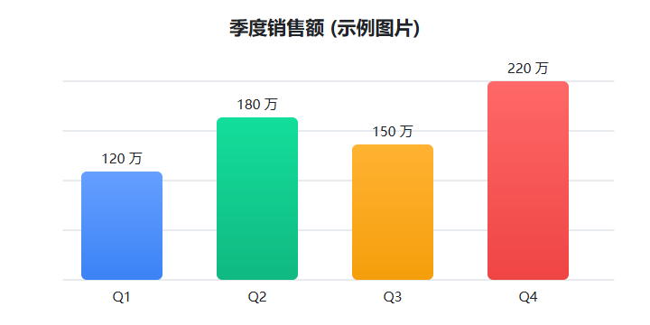

# MDReader 演示文档

这份文档用来演示 **MDReader** 对各种 Markdown 语法的渲染效果，尤其是 *表格* 和 *图片*。

[TOC 跳转: 表格](#表格) · [图片](#图片) · [代码](#代码高亮)

## 表格

| 产品       |   单价 | 库存 | 状态      | 备注                 |
| :--------- | -----: | :--: | :-------- | :------------------- |
| 机械键盘   |  ¥ 399 |  52  | ✅ 在售   | 支持 **热插拔**      |
| 无线鼠标   |  ¥ 129 | 230  | ✅ 在售   | `2.4G` + 蓝牙        |
| 4K 显示器  | ¥ 2499 |  8   | ⚠️ 紧张   | 含 ~~旧款~~ 新款支架 |
| USB-C 扩展坞 |  ¥ 299 |  0   | ❌ 缺货   | [查看详情](#图片)    |

> 提示：把光标放在上面的表格里，按 **Ctrl+Alt+T** 可以自动对齐各列（中文按两个字符宽度计算）。

英文表格：

| Name  | Language | Stars |
|-------|----------|------:|
| Qt    | C++      | 9,000 |
| Flask | Python   | 66,000 |

## 图片

本地 PNG（相对路径）：



SVG 矢量图 和 文件名带空格 / 中文 的图片：

  

使用 HTML 指定宽度：


不存在的图片会显示占位提示：


## 代码高亮

```python
from dataclasses import dataclass

@dataclass
class Point:
    x: float
    y: float

    def length(self) -> float:
        return (self.x ** 2 + self.y ** 2) ** 0.5
```

```javascript
const greet = (name) => console.log(`Hello, ${name}!`);
greet("MDReader");
```

## 列表

1. 第一步：打开文件
2. 第二步：编辑
   - 支持嵌套列表
   - 回车自动续写列表符号
3. 第三步：保存

- [x] 读取 `.md` 文件
- [x] 渲染表格与图片
- [ ] 喝杯咖啡 ☕

## 引用与其他

> 好的工具应该让人感觉不到它的存在。
>
> —— 某位开发者

行内元素：`code`、**粗体**、*斜体*、~~删除线~~、[链接](https://commonmark.org)、自动转义 \*星号\*。

---

脚注示例[^note]。

[^note]: 这是脚注的内容。
